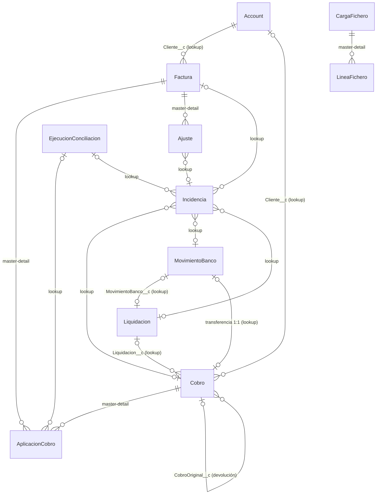

# 03. Modelo de datos

Versión 0.1 · 2 de noviembre de 2026 · Parte de: `01-as-is-to-be.md` (v0.2) y `02-requisitos.md` (v0.2)

Etiquetas: **[C]** confirmado o validado · **[D]** decisión de diseño de este documento, pendiente de revisión · **[S]** supuesto numérico · **[F]** falta.

Ningún objeto de este documento existe todavía en la org ni en el repo. Los nombres API son propuesta.

---

## 1. Principios del modelo

1. **Declarativo antes que Apex.** Los saldos se calculan con roll-up summary y fórmulas. Apex solo decide qué cobro va a qué factura.
2. **Inmutabilidad.** Factura, Cobro, MovimientoBanco y Liquidación solo los escribe su fuente (usuario de integración) o el motor. Los analistas los leen. Las correcciones van a `Ajuste__c`.
3. **Idempotencia por clave externa única** en todo lo que entra desde fuera.
4. **Ningún dato sensible en claro.** Sin datos de tarjeta. El IBAN llega enmascarado y con hash calculado fuera de Salesforce.
5. **Staging separado del modelo de negocio**, con purga diaria.

## 2. Diagrama entidad-relación

Staging del webhook (`AvisoPasarela__c`) y Custom Metadata no aparecen: no tienen relaciones.

## 3. Objetos de negocio

### 3.1 Account (estándar): cliente

Se reutiliza Account. Acceso a Account con licencia Platform: **visto en pantalla** (3-11-2026, captura del lanzador del usuario de integración, aparece «Cuentas»). Lectura de registros ajenos verificada el 3-11-2026: OWD de Account en Public Read Only interno y Private externo.

| Campo | Tipo | Notas |
|---|---|---|
| IdClienteErp__c | Text(30), External ID, único | Clave de upsert desde el ERP |

### 3.2 Factura__c

Fuente: ERP. Upsert nocturno.

| Campo | Tipo | Notas |
|---|---|---|
| NumeroFactura__c | Text(30), External ID, único | Clave de upsert (H3.1) |
| Cliente__c | Lookup(Account) | Lookup y no master-detail: no se ata la propiedad ni el sharing a la cuenta |
| FechaEmision__c | Date | |
| FechaVencimiento__c | Date | |
| Importe__c | Currency(16,2) | |
| Moneda__c | Text(3) | ISO 4217. Distinto de EUR: incidencia `Divisa no soportada` |
| ImporteAplicado__c | Roll-up SUM(AplicacionCobro.Importe__c) | Declarativo |
| ImporteAjustado__c | Roll-up SUM(Ajuste.Importe__c) | Declarativo |
| SaldoPendiente__c | Fórmula: Importe − Aplicado − Ajustado | |
| EstadoConciliacion__c | Picklist | `Abierta`, `Parcialmente conciliada`, `Pendiente de abono`, `Conciliada`. Lo escribe el motor |

### 3.3 Cobro__c

Fuente: pasarela (tarjeta, devolución, contracargo) o banco (transferencia).

| Campo | Tipo | Notas |
|---|---|---|
| ClaveExterna__c | Text(64), External ID, único | Tarjeta: id de pasarela. Transferencia: clave del movimiento |
| Tipo__c | Picklist | `Tarjeta`, `Transferencia`, `Devolución`, `Contracargo` |
| Fecha__c | Date | |
| ImporteBruto__c | Currency(16,2) | Negativo en devolución y contracargo |
| Comision__c | Currency(16,2) | Solo tarjeta |
| ImporteNeto__c | Fórmula: Bruto − Comisión | |
| ImporteAplicado__c | Roll-up SUM(AplicacionCobro.Importe__c) | |
| Moneda__c | Text(3) | |
| Concepto__c | Text(255) | Donde la regla 1 busca el número de factura |
| Cliente__c | Lookup(Account) | Puede ir vacío en B2C |
| Liquidacion__c | Lookup(Liquidacion__c) | Lookup: el cobro existe antes que su liquidación |
| MovimientoBanco__c | Lookup(MovimientoBanco__c) | Solo transferencias |
| CobroOriginal__c | Lookup(Cobro__c) | Devolución y contracargo |
| EstadoAbono__c | Picklist | `Pendiente de abono`, `Abonado` (H4.7) |
| TokenPasarela__c | Text(64) | Nunca el número de tarjeta (H6.3) |
| MarcaTarjeta__c | Text(20) | |
| UltimosDigitos__c | Text(4) | |
| NombrePagador__c | Text(80) | Enmascarado. `Anonimizado` tras el plazo (H6.4) |
| Anonimizado__c | Checkbox | |

### 3.4 AplicacionCobro__c (objeto de unión N:M)

Parte del cobro aplicada a una factura.

| Campo | Tipo | Notas |
|---|---|---|
| Factura__c | Master-detail(Factura__c), primario | Propietario y sharing heredados de la factura |
| Cobro__c | Master-detail(Cobro__c), secundario | |
| Importe__c | Currency(16,2) | |
| Origen__c | Picklist | `Regla referencia`, `Regla importe`, `Manual` |
| Ejecucion__c | Lookup(EjecucionConciliacion__c) | Vacío si es manual |
| ClaveUnica__c | Text(40), único | Id de factura + id de cobro. Impide aplicar dos veces el mismo par |

Dos master-detail permiten roll-up en los dos lados [C]. Coste: cada alta bloquea la factura y el cobro a la vez (ver sección 7).

### 3.5 Liquidacion__c

| Campo | Tipo | Notas |
|---|---|---|
| Referencia__c | Text(64), External ID, único | La que aparece en el concepto del abono |
| Fecha__c | Date | |
| ImporteNeto__c | Currency(16,2) | Neto declarado por la pasarela |
| SumaNetoCobros__c | Currency(16,2) | La calcula Apex al cargar. Lookup: no admite roll-up |
| MovimientoBanco__c | Lookup(MovimientoBanco__c) | |
| Estado__c | Picklist | `Pendiente de abono`, `Abonada`, `Descuadrada` |

### 3.6 MovimientoBanco__c

| Campo | Tipo | Notas |
|---|---|---|
| ClaveExterna__c | Text(64), External ID, único | Hash de fecha valor + importe + referencia bancaria (H2.3) |
| FechaValor__c | Date | |
| Importe__c | Currency(16,2) | Solo abonos |
| Concepto__c | Text(255) | |
| Tipo__c | Picklist | `Liquidación pasarela`, `Transferencia`, `Otro` |
| IbanMascara__c | Text(34) | `ES12 **** **** **** **** 1234` |
| IbanHash__c | Text(64) | HMAC-SHA256 calculado por el script de conversión [D] |
| Estado__c | Picklist | `Pendiente`, `Casado`, `Sin factura` |

**Decisión [D]: el IBAN en claro nunca entra en Salesforce.** El script que convierte el extracto a CSV calcula el hash con una clave que Salesforce no conoce. Un hash sin clave no protege: el espacio de cuentas de un banco es de unos 10.000 millones y se recorre por fuerza bruta.

### 3.7 Ajuste__c

Corrección registrada en lugar de editar el origen (H5.3).

| Campo | Tipo | Notas |
|---|---|---|
| Factura__c | Master-detail(Factura__c) | Habilita el roll-up `ImporteAjustado__c` |
| Incidencia__c | Lookup(Incidencia__c) | Obligatorio por validation rule |
| Importe__c | Currency(16,2) | |
| Motivo__c | Text Area(255), obligatorio | |

En el MVP, un ajuste siempre corrige el saldo de una factura. Una liquidación descuadrada se resuelve escalando, no con ajuste [D].

### 3.8 Incidencia__c

| Campo | Tipo | Notas |
|---|---|---|
| Tipo__c | Picklist | Los 11 tipos de H5.1 |
| Estado__c | Picklist | `Abierta`, `Escalada`, `Resuelta`, `Cerrada` |
| Motivo__c | Text Area(255) | Generado por el motor |
| Factura__c, Cobro__c, MovimientoBanco__c, Liquidacion__c | Lookups | Al menos uno, por validation rule |
| Ejecucion__c | Lookup(EjecucionConciliacion__c) | |
| ClaveOrigen__c | Text(80), único | Tipo + id de origen. Evita duplicar la incidencia en la siguiente ejecución (H5.1) |
| AccionResolucion__c | Picklist | `Aplicar`, `Ajustar`, `Escalar` |
| HorasAbierta__c | Fórmula (NOW − CreatedDate) | |
| FueraDePlazo__c | Fórmula checkbox: más de 48 h y no cerrada | CA-3 |

Propietario: cola `Conciliación - Analistas`. Al escalar pasa a la cola `Conciliación - Responsables` [D].

### 3.9 EjecucionConciliacion__c

| Campo | Tipo | Notas |
|---|---|---|
| Name | Auto Number `EJ-{00000}` | |
| Tipo__c | Picklist | `Programada`, `Manual` |
| Estado__c | Picklist | `En curso`, `Completada`, `Error de cuadre`, `Error` |
| Inicio__c, Fin__c | Date/Time | CA-2 |
| Leidos__c, Conciliados__c, Incidencias__c, Duplicados__c | Number(9,0) | |
| Cuadra__c | Fórmula checkbox: Leídos = Conciliados + Incidencias + Duplicados | CA-4 |

Un registro `En curso` impide lanzar otra ejecución (H4.1).

## 4. Staging

Se purga a diario tras procesar (H4.9).

### 4.1 AvisoPasarela__c (webhook)

| Campo | Tipo | Notas |
|---|---|---|
| IdEvento__c | Text(64), External ID, único | Segundo aviso igual: estado `Duplicado` (H1.2) |
| TipoEvento__c | Text(40) | |
| Datos__c | Long Text(32768) | JSON ya filtrado por el relé: sin datos de tarjeta |
| Estado__c | Picklist | `Recibido`, `Procesado`, `Duplicado`, `Error` |
| Error__c | Text(255) | Sin datos personales |

### 4.2 CargaFichero__c y LineaFichero__c (extracto y liquidación)

El control del fichero entero (H2.2) se hace con roll-ups, sin Apex:

| Objeto | Campo | Tipo | Notas |
|---|---|---|---|
| CargaFichero__c | HashFichero__c | Text(64), External ID, único | El mismo fichero dos veces se rechaza (H2.3) |
| | Fuente__c | Picklist | `Extracto`, `Liquidación` |
| | LineasDeclaradas__c, ImporteDeclarado__c | Number, Currency | Del pie del fichero |
| | LineasCargadas__c | Roll-up COUNT(LineaFichero) | |
| | ImporteCargado__c | Roll-up SUM(LineaFichero.Importe__c) | |
| | Cuadra__c | Fórmula checkbox | El motor solo procesa cargas que cuadran |
| LineaFichero__c | CargaFichero__c | Master-detail | |
| | Importe__c, Datos__c | Currency, Long Text | |

Facturas: upsert directo sobre `Factura__c`. Un error de fila no invalida las demás (H3.1).

## 5. Custom Metadata

| Tipo | Campos | Registro |
|---|---|---|
| ConfiguracionConciliacion__mdt | Tolerancia__c (0,05), VentanaDias__c (5), DiasPlazoAbono__c (3), DiasPurga__c (30), MesesAnonimizacion__c (24) | Uno: `Default` [S en los valores] |
| ReglaConciliacion__mdt | Orden__c, Activa__c | `Referencia`, `ImporteCliente` [D, se cierra en el ADR del motor] |

Editar registros de Custom Metadata exige el permiso `Customize Application` [C]. Lo hace el administrador, no el responsable financiero. H4.4 se cumple (sin deploy), pero con un administrador de por medio.

## 6. Seguridad

**OWD:** Public Read Only en todos los objetos custom [D]. El control real está en los permisos de objeto. Sin Permission Set no se ve nada (CA-6).

| Objeto | Integración | Analista | Responsable | Auditor |
|---|---|---|---|---|
| Account | CRE | R | R | R |
| Factura__c | CRE | R | R | R |
| Cobro__c, MovimientoBanco__c, Liquidacion__c | CRE | R | R | R |
| AplicacionCobro__c | — | CR | CR | R |
| Ajuste__c | — | CR | CR | R |
| Incidencia__c | — | RE | RE | R |
| EjecucionConciliacion__c | — | R | R | R |
| AvisoPasarela__c, CargaFichero__c, LineaFichero__c | CR | — | R | R |

C = crear, R = leer, E = editar. Nadie tiene Delete en objetos de negocio. El motor escribe con el usuario que programa el job (sección 7 del ADR).

**Cierre de incidencias escaladas (H5.4):** validation rule que solo deja pasar a `Cerrada` a quien tenga el Custom Permission `Conciliacion_CerrarEscaladas`, incluido solo en el Permission Set de responsable [D].

**Auditoría (H6.5):** Field History Tracking en `Incidencia__c` (Estado, Owner, AccionResolucion) y `Factura__c` (EstadoConciliacion).

## 7. Volumen, límites y hasta dónde llega

| Riesgo | Cuándo aparece | Mitigación |
|---|---|---|
| Bloqueo de filas en roll-ups | Una transferencia B2B repartida entre varias facturas, en lotes paralelos | El batch agrupa por cobro: todas las aplicaciones de un cobro en el mismo lote |
| Skew de lookup en Account | Un cliente con más de 10.000 facturas | Carga del ERP ordenada por cliente, o modo serie de Bulk API |
| Consultas no selectivas | Más de 1 millón de facturas | Filtrar con `EstadoConciliacion__c IN ('Abierta', 'Parcialmente conciliada')` y pedir índice custom sobre ese campo |
| Almacenamiento | Staging a 20.000 cobros al día son unos 40 MB al día [S] | Purga diaria. En la org de demo no se cargan esos volúmenes |
| Field History | Retención limitada por la plataforma | Comprobar el plazo actual antes de prometerlo en auditoría [F] |

El modelo aguanta el volumen objetivo (200.000 cobros al día) sin cambios de estructura. Los cambios a partir de ahí son de proceso: lotes, índices y purga.

## 8. Información que falta

| # | Dato | Afecta a |
|---|---|---|
| ~~F-9~~ | ~~Moneda corporativa de la org~~ Cerrado 2-11-2026: Currency Locale Spanish (Spain) - EUR, multidivisa desactivada [C] | Campos Currency en EUR |
| F-10 | Retención actual de Field History Tracking | Promesa de auditoría |

## 9. Decisiones de este documento para revisar

1. Account estándar como cliente, con lookup desde Factura (no master-detail).
2. AplicacionCobro con dos master-detail para tener roll-up en los dos lados.
3. Ajuste__c en master-detail con Factura.
4. Hash del IBAN con clave, calculado fuera de Salesforce.
5. Control de fichero por roll-ups en CargaFichero__c.
6. OWD Public Read Only más permisos de objeto, sin reglas de sharing.

## Siguiente documento

`04-diagramas.md`: arquitectura de integración (pasarela, relé, banco, ERP), secuencia del webhook y secuencia del batch de conciliación.
