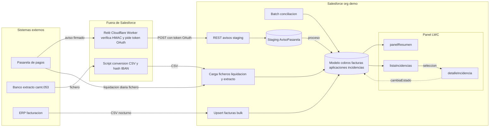
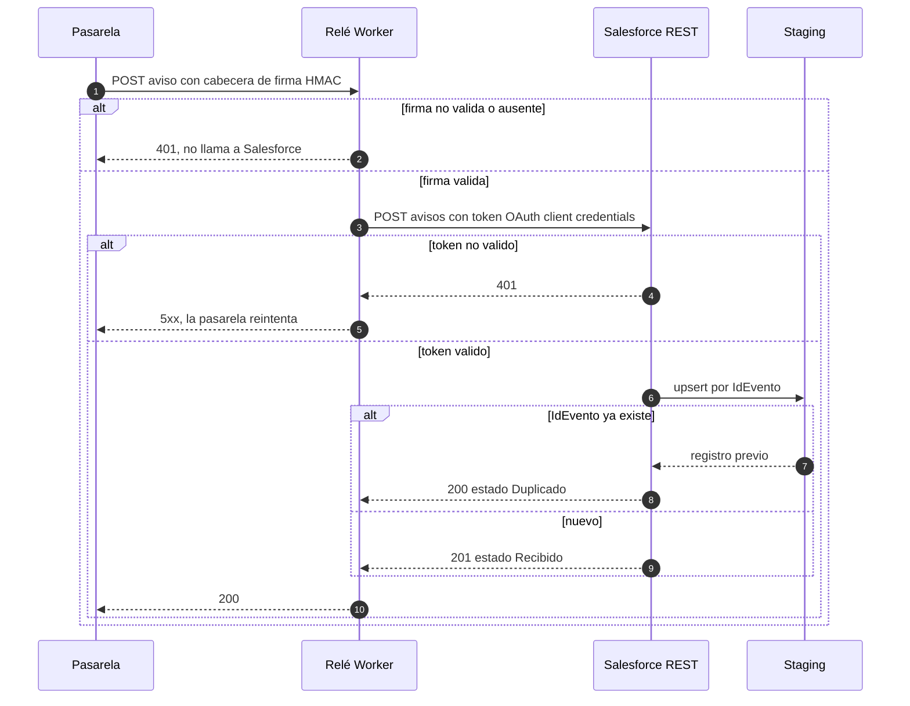
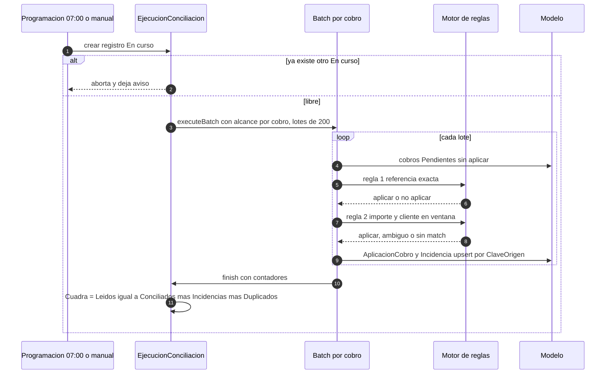

# 04. Diagramas de arquitectura y secuencia

Versión 0.2 · 3 de noviembre de 2026 · Parte de: `01` (v0.2), `02` (v0.2) y `03` (v0.1)

Etiquetas: **[C]** validado · **[D]** decisión de este documento, pendiente de revisión · **[S]** supuesto · **[F]** falta.

Mermaid es la fuente de verdad. Cada diagrama se ha renderizado con `mmdc` antes de incluirlo. Si cambia un flujo, se cambia el bloque y se vuelve a renderizar.

---

## 1. Arquitectura de integración

Qué entra, por dónde, y dónde se guarda el resultado.

**Lectura:** el panel son tres componentes LWC: resumen, lista y detalle. La acción `cambiaEstado` vuelve desde el detalle a `Incidencia__c`. Los datos sensibles se transforman antes de entrar. El IBAN se hashea fuera (script), y el webhook pasa por el relé, que verifica la firma. Salesforce solo ve datos ya limpios.

**Decisiones [D]:**

- El relé no guarda avisos. Si Salesforce no responde, devuelve 5xx y la pasarela reintenta. Así no hay una segunda copia de los datos fuera de la org.
- El ERP no tiene API en este caso [F-7]. Entrega un CSV nocturno y se carga con `sf data upsert bulk`. Si el ERP tuviera API, cambiaría solo la entrada.
- Fuera de Salesforce quedan el script de conversión y el relé. No hay Apex fuera de la org.

## 2. Secuencia del webhook de cobros

Un aviso de la pasarela, desde que llega hasta que queda en staging.

**Lectura:** hay tres puertas. La firma se verifica en el relé. El token se verifica en Salesforce. El duplicado se detecta en la base de datos, con upsert por `IdEvento` (H1.2).

**Decisiones [D]:**

- **Duplicado responde 200, no 409.** Si respondiera 409, la pasarela seguiría reintentando. Con 200 deja de hacerlo.
- **El relé devuelve 5xx ante un fallo de Salesforce.** Así la pasarela reintenta, y el aviso no se pierde.
- **Un aviso no se procesa en la misma llamada.** Staging recibe el aviso y el proceso de conciliación lo recoge después. Así la respuesta a la pasarela no depende de la carga del batch.

## 3. Secuencia del batch de conciliación

Una ejecución completa, desde que se programa hasta el cuadre.

**Lectura:** la ejecución se bloquea a sí misma (un solo `En curso`). Cada lote trabaja por cobro, de modo que una transferencia repartida entre varias facturas se resuelve en un único lote. Al final, el cuadre es una fórmula y no un cálculo de Apex.

**Decisiones [D]:**

- **Batch y no Queueable.** Con 20.000 cobros al día, el volumen está en el rango que justifica el batch (decenas de miles). Un Queueable encadenado serviría para cientos, no para ese volumen.
- **Alcance por cobro.** Varios lotes en paralelo podrían tocar la misma factura y bloquearse. Agrupar por cobro evita ese conflicto dentro de un mismo cobro. Entre cobros distintos la factura sí puede repetirse: se gestiona con el orden de reglas y `ClaveUnica__c` en AplicacionCobro.
- **Incidencia con ClaveOrigen.** Un upsert por ClaveOrigen evita abrir dos veces la misma incidencia en ejecuciones distintas.
- **El batch no llama a servicios externos.** Solo trabaja con datos de Salesforce. Así no hay callouts dentro de batch que compliquen el reintento.

## 4. Cuadre: qué comprueba y qué no

| Comprobación | Dónde | Si falla |
|---|---|---|
| Cada fichero cuadra con su pie (líneas e importe) | CargaFichero__c, roll-up | El fichero no se procesa (H2.2) |
| Cada liquidación cuadra con la suma de sus cobros | Liquidacion__c, Apex al cargar | Incidencia `Liquidación descuadrada` |
| Leídos = conciliados + incidencias + duplicados | EjecucionConciliacion__c, fórmula | Estado `Error de cuadre` (H4.8) |
| Saldo de factura = importe − aplicado − ajustado | Factura__c, fórmula | No se cierra la factura |

El cuadre de la ejecución se comprueba con una fórmula. No depende de que el batch termine bien: si un lote falla a medias, la ejecución no cuadra y queda visible.

## 5. Hasta qué volumen aguanta

| Punto | Límite aproximado | Qué cambiar después |
|---|---|---|
| Webhook REST | Límite de llamadas REST de la org por 24 h (15.000 en esta org, visto en Company Information) | Pasar a cola con Platform Event o a Bulk API (F2) |
| Batch de conciliación | Pensado para 20.000 cobros al día y diseño para 200.000 [S] | Más lotes en paralelo, siempre por cobro |
| Staging | Purga diaria | Si el día supera el almacenamiento, purgar en mitad del día |
| Carga de facturas | Bulk API, lotes de decenas de miles | Mismo diseño |

Ningún diagrama cambia al crecer el volumen. Cambian los parámetros: tamaño de lote, frecuencia de purga y, en el caso del webhook, el paso a Platform Event.

## 6. Pendiente antes del ADR

1. Confirmar que la pasarela soporta cabecera de firma HMAC. Si usa otro método, cambia solo el relé [F].
2. Confirmar el límite de llamadas REST de la org de demo, que aparece en Company Information como 15.000 por 24 h [C].
3. Decidir el formato del CSV de liquidación con la pasarela [F-4 y F-6].

## Siguiente documento

`05-adr.md`: una decisión por ADR, con la alternativa descartada y lo que la haría cambiar. Empieza por: relé en Cloudflare, batch y no Queueable, Big Object descartado, AplicacionCobro con dos master-detail.
